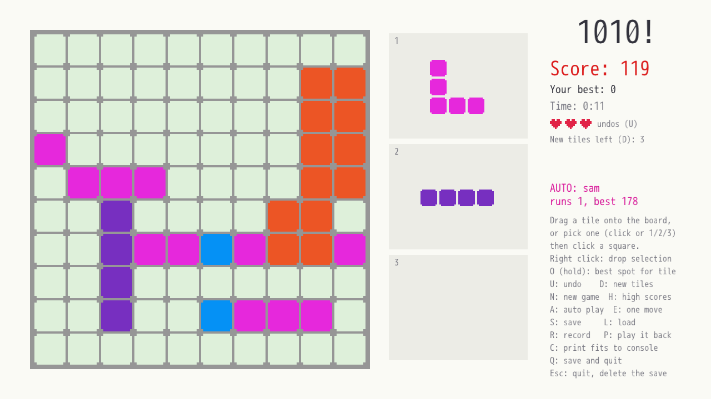

## 1010! for DragonRuby Game Toolkit

A port of the Gosu game at https://github.com/shanko/1010 to
[DragonRuby Game Toolkit](https://dragonruby.org). No gems or compiler needed:
the engine binary sits next to this folder.



### To play the game

From the `1010` folder:

```sh
./dragonruby                                     # play
./dragonruby mygame --auto                       # the computer plays, game after game
./dragonruby mygame --auto sam                   # choose its strategy: first_fit, last_fit, random_fit, shanko, jc, sam
./dragonruby mygame --auto jc --seed 42          # the same tiles and moves every run
./dragonruby mygame --test tests/board_tests.rb  # run the unit tests
```

Drag one of the 3 tiles on the right onto the board, or pick one (click it, or press
1/2/3) and then click a square. A new tile takes the place of each one you place,
so there are always 3 to choose from. Full rows and columns are cleared, each
square placed scores 1 point, and the game ends when none of the tiles on offer fit.

Each game you get 3 undos (the hearts under the score) and 3 new sets of tiles
(D swaps the tiles on offer for another 3). An undo also takes back a new set.
When a game you played ends, its score goes into the high scores (H), kept in
`data/1010scores.txt`. Games the computer plays in auto mode don't count: the
panel shows their runs and best score instead.

| Key | Action |
|---|---|
| 1 / 2 / 3 | select a tile |
| O (hold) | show the best spot for the selected tile |
| U | undo the last move (3 times per game, shown as hearts) |
| D | swap the tiles on offer for a new set (3 times per game) |
| H | show the high scores instead of the help, and back |
| N | new game |
| A | auto mode on/off: the computer keeps playing games and tracks runs and best score |
| E | let the computer make one move |
| S / L | save / load (`data/1010game.txt`; it is loaded again at the next start) |
| R | record a new game (press R again to stop) |
| P | play back the last recording |
| C | print where each tile fits first (in the console) |
| Q | save and quit |
| Esc | quit without saving, and delete the saved game so the next start is a new game |
| Right click | drop the selected tile |

When the game closes, the time played (since it opened, over every game) and
the score are printed to the console.

### Logs and errors

Everything worth knowing about a session goes to the console (open it with the `` ` `` key), the
terminal and `data/1010.log` (with the date and time; it starts afresh each
session):

* the session's seed, so `--seed N` can repeat any session,
* each game's score, new high scores, saves and loads,
* warnings and errors, which also show below the board (orange and red).

Problems are reported instead of being ignored or crashing the game:

* a damaged save file says what is wrong (`row 4 is "0000090000", not 10 of
  the digits 012345`) and the current game goes on,
* a save or load that fails says so, and Q doesn't quit if the save failed,
* bad lines in the scores file are left out and logged,
* a bad `--seed` is reported, and a random seed used instead,
* a playback that doesn't match the board stops with an error,
* a strategy choosing a move that doesn't fit is reported as a bug, and auto
  mode stops,
* a crash logs the seeds, the mode and the board before DragonRuby shows it.

### Where things went

| Original (Gosu) | DragonRuby |
|---|---|
| `board.rb`, `class Board1010` | `app/board.rb`, `class Board` (rules only, no drawing; `Board#play` is one whole move and returns a `Move`) |
| `Board1010::TILES` (number matrices) | `app/tiles.rb`, `class Tile` (shapes drawn as text) |
| `auto_player.rb`, `class AutoPlayer` | `app/auto_player.rb`, `class AutoPlayer` (same strategies) |
| `move_animation.rb`, `class MoveAnimation` (milliseconds) | `app/move_animation.rb`, `class MoveAnimation` (ticks) |
| (new) | `app/leaderboard.rb`, `class Leaderboard`: the high scores |
| `puts` | `app/game_log.rb`, `module GameLog`: console, log file and levels |
| `game_1010.rb`, `class GameWindow < Gosu::Window` | `app/main.rb`, `class Game` (with `attr_dr` for `state`, `inputs`, `outputs`) |
| `Window#update` + `Window#draw` | `Game#tick`, called 60 times a second through the top-level `tick(args)` |
| `button_down` / `button_up` callbacks | checking `inputs.mouse.key_down.left`, `key_up.left`, `inputs.keyboard.key_down.u`, ... each tick |
| instance variables (`@selected_option`, ...) | `state` (`state.selected_option`, ...) |
| `draw_rect`, `draw_triangle`, `Gosu::Font#draw` | Hashes pushed onto `outputs.sprites` / `outputs.labels` |
| `KEY_ACTIONS` with `Gosu::KB_...` ids | `KEY_ACTIONS` with `key_down` names (`escape:`, `q:`, ...) |
| `Gosu.milliseconds` for the time played | `Kernel.tick_count` (60 ticks = 1 second) |
| `GameWindow#close` prints the time and score | `shutdown`, which DragonRuby calls however the game closes |
| `ruby game_1010.rb auto sam --seed 42` | `./dragonruby mygame --auto sam --seed 42` (read with `GTK.cli_arguments`), or press A while playing |
| `Random.new(seed)`, `sample(random:)` | `Random.new(seed)`, and `list[random.rand(list.length)]` |
| the window caption shows runs and max score | the panel shows them |

### Differences from the original

* Y grows **upwards** in DragonRuby. The board still numbers rows from the top
  like the original, and `cell_xy` in `main.rb` converts rows into screen y.
* Tile colors: the original gave every vertical line value 1 (green); here
  vertical lines are colored by length like horizontal ones.
* Auto mode and playback wait 8 ticks between moves, so you can watch.
* Starting a new game (or loading one) ends a playback in progress.
* A preview shows where the selected tile would land (red if it doesn't fit),
  options that can't fit anywhere are faded, and help is always on screen
  (instead of while H is held). Holding O shows the whole tile, not just its
  anchor square.
* Messages show below the board, and recording shows a blinking square and
  "REC" instead of a triangle.
* L loads the saved game while playing.
* A new tile is dealt as soon as you place one, so there are always 3 to choose
  from. The original dealt 3 new tiles only once all 3 were placed.
* 3 undos per game instead of one at a time, new sets of tiles (D), and high
  scores (H).
* A damaged save file is reported (see above) instead of crashing the game.
* Not ported: the terminal version (`terminal_game.rb`).

### DragonRuby gotchas found while porting

* `Integer / Integer` returns a Float (`7 / 2 == 3.5`). Use `idiv` or `.floor`.
* `args.state` (set to `{}` in `boot`) is a Hash read with dots. If a key has the
  same name as a method, the method wins: when the game's methods were top-level,
  `state.undo` called the `undo` method, and `rect.size` returns `Hash#size`.
  Keeping the methods inside `class Game` avoids most of these clashes.
* Missing or different from regular Ruby: `Random.new_seed`, `Array#sample(random:)`,
  `Struct.new(..., keyword_init: true)`, `Integer(text, exception: false)` and
  regular expressions. `max_by` can't compare arrays, and
  `each_with_index.to_h { ... }` returns nils instead of raising an error.
* `Kernel.tick_count` can be negative while tests run.
* `Time` has no `strftime`; build dates with `format` and `Time#year`, ... instead.
* `GTK.log_warn` and `log_debug` don't reach `logs/puts.log` or `logs/all.log`,
  and `log_info`/`log_error` add a prefix of their own, so `GameLog` uses `puts`.
* A test can't stub `DR.write_file` and put it back: `DR` forwards to the runtime,
  and removing the stub left the stub in place. The tests pass the game an
  unwritable file name (`data/\0...`) instead.
* A method definition without parentheses must not END with a required keyword
  argument. In `def board_squares cells, color, alpha:` DragonRuby read the next
  line as alpha's default value, so the method body silently did nothing.
  Write `def board_squares(cells, color, alpha:)` instead.
